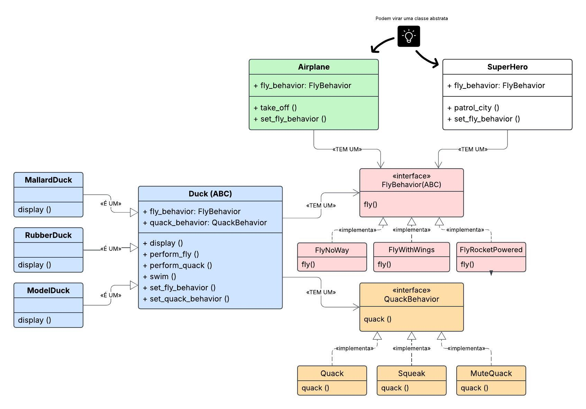

# Capítulo 1

# Padrão de Projeto Strategy (SimUDuck & Reutilização Polimórfica)

Projeto prático desenvolvido em Python com base nos conceitos apresentados no livro *"Use a Cabeça! Padrões de Projetos"* (Capítulo 1).

O objetivo é demonstrar a aplicação do padrão comportamental **Strategy**, explorando o desacoplamento de comportamentos e a reutilização de código entre entidades de domínios distintos por meio de composição.

---

## 🎯 Problema e Princípios de Design

A abordagem inicial ingênua baseada em herança clássica (onde todos os comportamentos pertencem à classe mãe `Duck`) gera dois problemas críticos de manutenção:

1. Comportamentos inadequados herdados por subclasses (ex.: patos de borracha voando).
2. Duplicação de código ao tentar sobrescrever comportamentos em várias classes.

Para resolver isso, o projeto aplica três princípios fundamentais de Orientação a Objetos:

1. **Encapsule o que varia:** Identifique os aspectos que mudam frequentemente e separe-os do que permanece constante.
2. **Programe para uma interface, não para uma implementação:** Use abstrações (`ABC`) para definir contratos de comportamento.
3. **Favoreça a composição em vez da herança:** Em vez de *ser* um voador, o objeto *tem* uma estratégia de voo (`HAS-A` vs. `IS-A`).

---

## 🧩 Estrutura do Projeto

- `FlyBehavior.py`: Interface abstrata `FlyBehavior` e suas implementações concretas (`FlyWithWings`, `FlyNoWay`, `FlyRocketPowered`).
- `QuackBehavior.py`: Interface abstrata `QuackBehavior` e suas implementações concretas (`Quack`, `Squeak`, `MuteQuack`).
- `Duck.py`: Superclasse abstrata `Duck` e subclasses concretas (`MallardDuck`, `RubberDuck`, `ModelDuck`).
- `Airplane.py`: Classe que consome `FlyBehavior`, demonstrando a reutilização do comportamento fora da hierarquia de patos.
- `SuperHero.py`: Outra entidade de domínio distinto que também consome `FlyBehavior`.
- `main.py`: Ponto de entrada com os cenários de execução e troca dinâmica de estratégias.

---

## 📐 Modelagem UML

Clique na imagem para abrir no Google Drive.